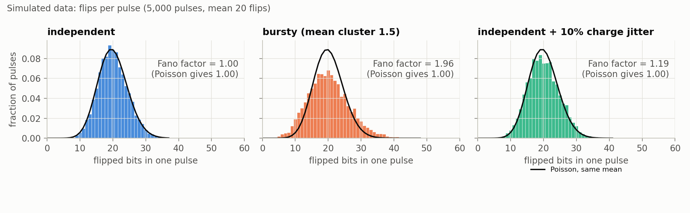
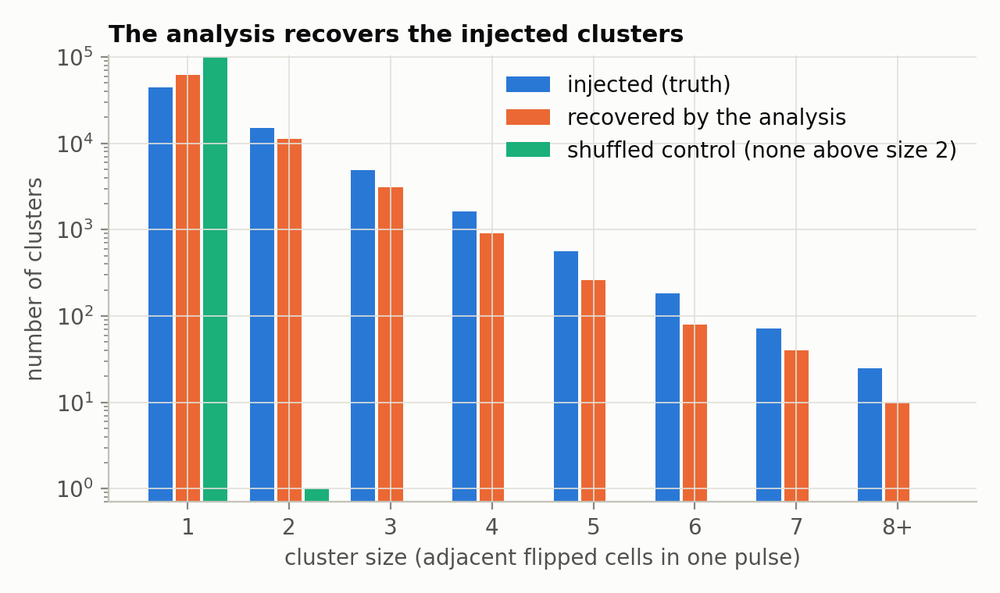
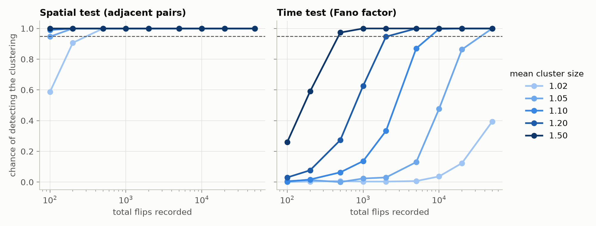
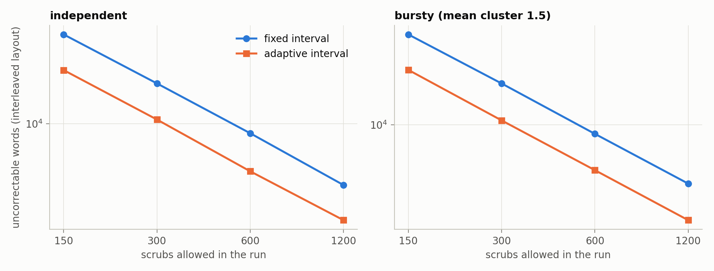
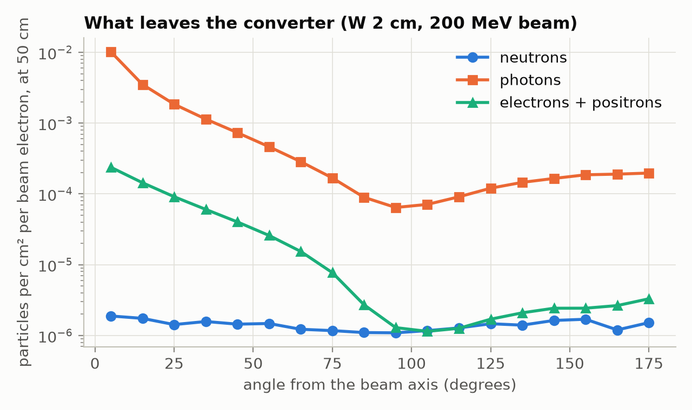
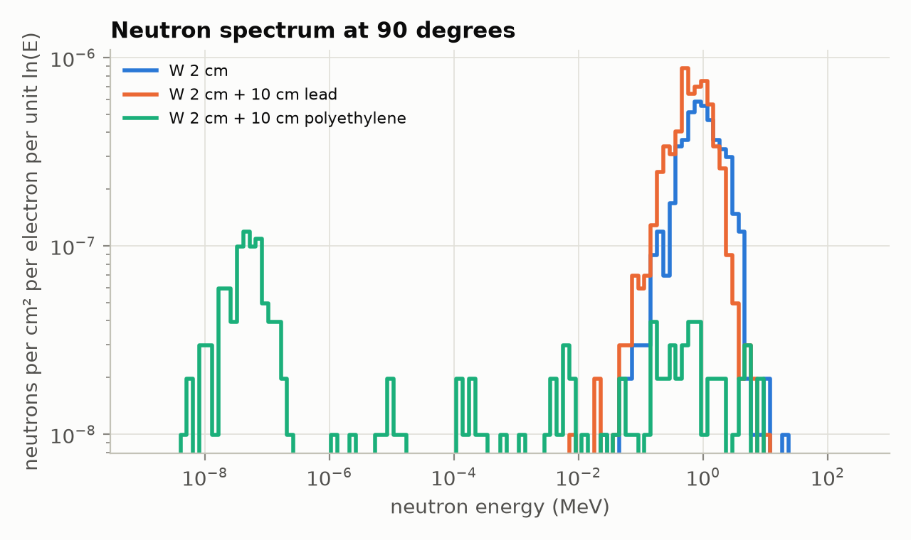
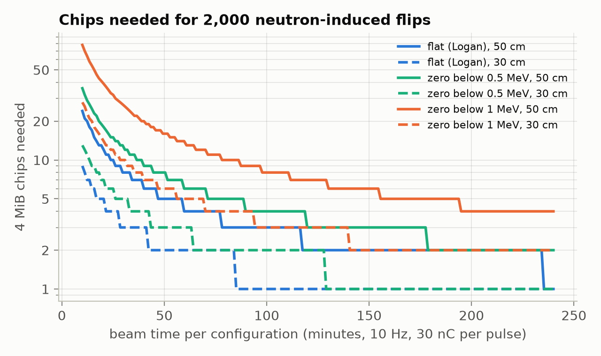
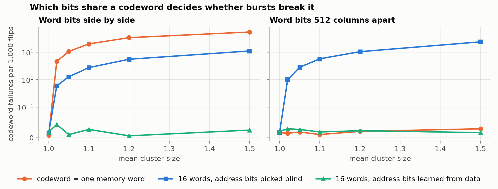

# BURST: preliminary results and what they change

**Status: simulation only.** Nothing here is beam data. We injected bit flips with a known amount of clustering into a virtual 917,504-bit memory, ran the analysis we plan to run on CLEAR data, and checked that it recovers what we put in. Code: `burst_sim/burst_sim.py`. Numbers: `burst_sim/results.json`. Figures: `burst_sim/figures/`.

Re-run with `burst_sim/.venv/bin/python burst_sim/burst_sim.py` (about 20 seconds, fixed random seed).

## What the fault-injection study shows

### 1. The time test works, and beam charge jitter fakes a positive

| Injected data (5,000 pulses, 20 flips each) | Fano factor measured | Expected from injection | Verdict |
|---|---|---|---|
| Independent flips | 1.00 | 1.00 | consistent with Poisson (p = 0.40) |
| Bursty, mean cluster 1.5 | 2.03 | 2.00 | Poisson rejected |
| Independent, 10% charge jitter | 1.20 | 1.20 | Poisson rejected (p = 4e-22), **wrongly** |
| Same, after dividing by measured charge | 1.00 | 1.00 | consistent with Poisson (p = 0.44) |

The Fano factor is variance divided by mean of the flips per pulse; independent flips give 1. A 10% pulse-to-pulse variation in bunch charge produces a false clustering signal unless every pulse is normalised to its measured charge. **The proposal must request the per-pulse charge reading from CLEAR.**

### 2. The spatial test recovers the injected clusters

- Injected mean cluster size 1.497; recovered 1.496. Injected multi-cell fraction 33.3%; recovered 33.2%.
- Adjacent flipped pairs: 33,287 observed against 2.6 expected for independent flips.
- Shuffled control (same flips per pulse, random addresses): 4 pairs against 2.6 expected, p = 0.27. No false signal.

### 3. Clustering breaks a Hamming code unless the bits are interleaved

Uncorrectable Hamming(7,4) words in 20,000 pulses (about 400,000 flips), scrubbing after every pulse:

| Mean cluster size | Word bits side by side | Word bits interleaved | Shuffled control |
|---|---|---|---|
| 1.00 | 27 | 27 | 21 |
| 1.02 | 1,724 | 41 | 31 |
| 1.11 | 7,965 | 36 | 20 |
| 1.50 | 20,371 | 31 | 37 |
| 2.00 | 24,995 | 22 | 32 |

The independent-error formula predicts 26. Even 2% of flips arriving as pairs raises failures about 65-fold when a word's bits are physical neighbours. Interleaving returns the rate to the independent level. Brute-force check included: Hamming(7,4) fails for exactly the error patterns with two or more flipped bits.

### 4. How many flips we need (this sets the beam-time request)

Flips needed for a 95% chance of detecting clustering at a 0.1% false-alarm threshold:

| Mean cluster size | Spatial test | Time test |
|---|---|---|
| 1.02 | 500 | more than 50,000 |
| 1.05 | 200 | 50,000 |
| 1.10 | 100 | 10,000 |
| 1.20 | 100 | 5,000 |
| 1.50 | 100 | 500 |

The spatial test is 5 to over 100 times more sensitive. False-alarm rates on independent data at a 5% threshold were 4.2% (spatial) and 5.9% (time), as they should be.

### 5. Adaptive scrubbing helps one failure type and not the other

Beam alternating between 30 and 300 flips per pulse; a controller scrubs faster when its running estimate of the flip rate is higher, using the same number of scrubs as a fixed schedule.

- Interleaved layout: 38 to 40% fewer uncorrectable words at every scrub budget, for independent and bursty flips alike.
- Side-by-side layout with bursty flips, 1,200 scrubs: 54,849 fixed against 53,614 adaptive, a 2% gain. Those failures happen inside a single pulse, so no scrub schedule can prevent them.

### 6. Clusters can be found without knowing the chip's layout
Code: `burst_sim/blind_bitmap.py`. Numbers: `burst_sim/results_blind.json`.

A real memory scrambles logical addresses before they reach a physical row and column, and manufacturers rarely publish the map. We hid the injected clusters behind an unknown scramble and gave the analysis only what the microcontroller would log: pulse number, word address, bit number.

**Method.** For every pair of flips in the same pulse, take the XOR of the two logical addresses. Unrelated pairs spread over about a million possible values. Physical neighbours give the same few values again and again.

| Flips recorded | Injected mean cluster | Recovered, layout known | Recovered, layout unknown | Shuffled control |
|---|---|---|---|---|
| 2,070 | 1.491 | 1.490 | 1.465 | 1.000 |
| 10,067 | 1.497 | 1.497 | 1.488 | 1.000 |
| 99,040 | 1.499 | 1.498 | 1.499 | 1.000 |

The shuffled control never learned a single false signature.

Flips needed for a 95% chance of detection at a 0.1% false-alarm threshold:

| Mean cluster size | Layout known | Layout unknown |
|---|---|---|
| 1.02 | 500 | 2,000 |
| 1.05 | 200 | 500 |
| 1.10 | 100 | 200 |
| 1.20 | 100 | 200 |
| 1.50 | 100 | 100 |

Not knowing the layout costs a factor of 2 to 4 in data, not a factor of 100. False-alarm rate on independent data at a 5% threshold: 3.2%.

**The decoder question needs no layout at all.** Counting words that hold two or more flips after one pulse uses only logical addresses. In 100,000 bursty flips: 5 such words on an interleaved chip (shuffled control 2), 5,157 on a side-by-side chip (shuffled control 3). So the experiment tells us directly whether a given chip's own layout protects a code against bursts.

**Limits.** The scramble modelled is a permutation and inversion of address bits, which is common but not universal. A chip with an arbitrary lookup-table scramble or spare-row remapping would weaken the method. It also relies on few flips per pulse; at hundreds per pulse the chance pairs swamp the signal.

### 7. What the CLEAR beam produces behind a converter (Geant4)
Code: `burst_sim/flux_sim.py`. Numbers: `burst_sim/results_flux.json`. Raw histograms: `burst_sim/flux_raw/`.

Geant4 (physics list QGSP_BIC_HP), 200 MeV electrons on a 5 cm diameter tungsten disc, 80,000 beam electrons per setup. Everything is per beam electron at 50 cm from the target, so it scales with bunch charge and with 1/distance². The 200 MeV beam energy is an assumption until the Beams & Detectors document is read. Geant4 photonuclear yields carry roughly a factor-2 model uncertainty.

**Converter thickness.** Neutrons per beam electron: 0.004 (0.35 cm), 0.019 (1 cm), 0.042 (2 cm), 0.053 (5 cm). Most of the gain is reached by 2 cm.

**Where to put the chip.** Neutrons leave almost evenly in all directions; photons and electrons are thrown forward.

| Position (2 cm tungsten, no shield) | Neutrons per cm² | Photons per cm² | Photons per neutron |
|---|---|---|---|
| On the beam axis | 1.9e-6 | 1.0e-2 | about 5,400 |
| At 90 degrees | 1.1e-6 | 7.7e-5 | about 70 |

**What a shield does at 90 degrees.**

| Shield | Neutrons per cm² | Neutrons above 1 MeV | Photons per cm² | Rough dose (Gy per beam electron) |
|---|---|---|---|---|
| None | 1.10e-6 | 5.4e-7 | 7.7e-5 | 1.1e-15 |
| 10 cm lead | 1.41e-6 | 4.9e-7 | 1.0e-6 | 9.6e-18 |
| 10 cm polyethylene | 3.6e-7 | 3.4e-8 | 1.6e-4 | 7.5e-16 |

- **Lead is a neutron-pass filter.** It cuts photons 74-fold and dose over 100-fold while leaving the neutrons untouched.
- **Polyethylene converts fast neutrons to slow ones.** It cuts neutrons above 1 MeV 16-fold and creates a thermal peak near 0.05 eV.

**The neutrons are about 1 MeV, not high-energy.** Mean energy 1.2 MeV with no shield and 0.87 MeV behind 10 cm of lead; under 1% are above 10 MeV. Most published memory upset cross-sections are for neutrons above 10 or 20 MeV, so they do not apply directly. This is the single biggest uncertainty in the rate.

**First rate estimate (cross-sections from memory; superseded by section 8).** Behind 10 cm of lead at 90 degrees and 50 cm: 8,800 neutrons per cm² per nC of beam. For a 16 Mbit memory:

| Assumed upset cross-section per bit at about 1 MeV | Flips per µC of beam, one 16 Mbit chip | Beam charge for 2,000 flips with 16 chips |
|---|---|---|
| 1e-16 cm² (pessimistic) | 0.015 | 8,300 µC |
| 1e-15 cm² | 0.15 | 830 µC |
| 1e-14 cm² (optimistic) | 1.5 | 83 µC |

If CLEAR delivers on the order of 0.1 µC per second (from memory, unverified), that is 14 minutes to 23 hours. Feasible across most of the range, marginal at the pessimistic end. Moving the chips from 50 cm to 35 cm doubles the rate.

**Flips per pulse will be far below one,** which is exactly the regime where the layout-blind method of section 6 works best.

**Dose is not a problem in the neutron field, and is the limit in the direct beam.** Behind lead the chip receives about 1.5e11 neutrons per cm² for each gray of dose. In the direct beam a chip takes roughly 1.7 Gy per nC per cm², so the direct-beam comparison must run at very low charge and will kill chips; budget several.

**Design consequence.** Three shield states at 90 degrees give three different radiation fields from one geometry: bare (photon-dominated), lead (fast neutrons), polyethylene (slow neutrons plus photons). That separates the mechanisms Logan asked about without moving the chip.

### 8. Upset rate with a real chip and published cross-sections (Logan's estimate)

Logan's write-up is in [radiation_estimates.md](radiation_estimates.md). It replaces the remembered cross-sections in the table above with measured ones for one reference chip, the ISSI IS61WV204816BLL (40 nm SRAM, 4 MiB): 1.61e-15 cm² per bit for 1.2 MeV neutrons and (4.74 ± 2.20)e-18 cm² per bit for 200 MeV electrons. All of Logan's arithmetic reproduces exactly in [burst_sim/rate_calc.py](burst_sim/rate_calc.py).

Assumed beam: 30 nC per pulse for the neutron arm, 0.01 nC per pulse on 1 cm² for the direct arm, 10 Hz.

Logan then found the chip's full neutron response in the same paper: measured values at 0.144, 1.2 and 17 MeV, a Weibull fit (saturation 1.40e-14 cm², threshold 0.01 MeV, width 14.05 MeV, shape 0.82), and a thermal-neutron cross-section of (3.16 ± 0.64)e-15 cm² per bit at 3.3 V. `rate_calc.py` folds this curve with the Geant4 spectrum of every configuration. For the thermal part it assumes a 1/v (boron-10-like) energy dependence normalised to the thermal value; that shape is our assumption.

| Configuration, 90°, 50 cm, 30 nC per pulse | Effective σ per bit | Flips per pulse, one chip | Share from the thermal term |
|---|---|---|---|
| W 2 cm, bare | 1.67e-15 | 0.0115 | 0% |
| W 2 cm + 10 cm lead | 1.26e-15 | 0.0112 | 0% |
| W 2 cm + 5 cm polyethylene | 1.64e-15 | 0.0091 | 55% |
| W 2 cm + 10 cm polyethylene | 1.93e-15 | 0.0044 | 75% |
| Direct electrons, 0.01 nC on 1 cm² | 4.74e-18 | 0.0099 (0.005 to 0.015 at 1σ) | |

**The fold lowers Logan's number by only 21%,** from 0.0142 to 0.0112 flips per pulse behind lead. The cross-section rises slowly with energy, so sub-MeV neutrons still upset bits, and the fast tail is worth more than σ(1.2 MeV). The earlier "up to 3.3× lower" bounds were too pessimistic. At 30 cm the rate is 0.031 flips per pulse per chip. The fit undershoots the 17 MeV point by a factor of 2, which does not matter here because under 1% of the neutrons are above 10 MeV.

**Polyethylene does not make the chip safer, as Logan predicted.** Behind 10 cm of polyethylene, 54% of the neutrons are thermal and they cause 75% of the upsets. That makes the polyethylene configuration a test of the boron-10 mechanism, not just a weaker field.

**Chips against beam time.** For 2,000 flips with the folded rate, the neutron arm needs 2 chips for one hour of beam at 30 cm (5 at 50 cm), or 1 chip for two hours at 30 cm. More memory and more beam time trade off directly.

**The direct-electron arm is limited by dose, not memory.** Only chips inside the ~1 cm² beam count; adding memory means stacking boards along the beam, not yet simulated. Each pulse gives about 0.017 Gy(Si), so 1,000 flips on one chip costs about 1.7 kGy. The dose per flip is fixed by the cross-section, so lowering the charge only stretches the time. Logan found that a chip from the same ISSI family stayed functional after 10 kGy of gamma dose, with its supply current roughly doubled (Li et al. 2022), so 1.7 to 3.4 kGy looks survivable. That paper's subject is also a warning: accumulated dose changes upset sensitivity, so the direct-arm cross-section may drift during the run. Logging flips against accumulated dose turns this into a measurement rather than a confound.

### 9. Error correction on the real chip at CLEAR rates

[burst_sim/decoder_chip.py](burst_sim/decoder_chip.py) redoes the decoder study for the reference chip (2M words × 16 bits, no on-chip error correction) at the folded rate of section 8: 0.031 flips per pulse per chip, 2 chips, read and rewritten every 10 pulses. The code is ours, run by the microcontroller, so we choose which 16 memory bits form one codeword. A single-error-correcting code fails when 2 or more flips land in one codeword between rewrites.

**Accumulated independent flips never break the code at these rates.** With 0.31 flips per chip per readout, the expected number of codewords hit twice in a whole 2,000-flip run is 1.5e-04. Even with no rewriting at all it is 0.48. So scrubbing, adaptive or not, has nothing to fix at CLEAR: every codeword failure we see will come from a burst. Section 5's adaptive-scrubbing result only applies at flip densities hundreds of times higher than this experiment reaches.

**Which bits share a codeword decides everything.** Failures per 1,000 flips (chance level about 0.02):

| Codeword | Word bits side by side, mean cluster 1.05 / 1.2 | Word bits 512 columns apart, 1.05 / 1.2 |
|---|---|---|
| One memory word | 10.6 / 33.5 | 0.02 / 0.02 |
| Same bit in 16 words, 4 address bits picked blind | 1.3 / 5.5 | 2.8 / 10.4 |
| Same bit in 16 words, address bits learned from the first 1,000 flips | 0.01 / 0.01 | 0.03 / 0.02 |

- Keeping a codeword inside one memory word is safe only if the chip spreads word bits apart, and we do not know whether it does.
- Spreading a codeword over 16 words by picking address bits blind is a gamble: 60% of choices are bad at mean cluster 1.2 in the interleaved layout, because some address bits switch between physical neighbours.
- **Learning the grouping from the chip's own flips works.** Physical neighbours differ in the low physical address bits, so those bits keep appearing in the learned same-window address differences (section 6). Choosing the 4 address bits that appear least brings failures down to chance level in every case simulated, from 1,000 training flips and without the layout.

**What this means for the experiment.** Because every flip is logged with its pulse number, any code, grouping and scrub schedule can be replayed offline on the same data. One run tests them all, and a train-on-the-first-half, test-on-the-second-half split makes the learned grouping an honest prediction rather than a fit.

**Assumptions.** Address scrambling is a bit permutation plus inversion; real chips can scramble less simply. Cluster shapes are line-shaped with geometric sizes. The 10-pulse readout interval assumes the microcontroller can read 4 MiB in about a second.

## What this changes in the proposal

1. **Sharper hypothesis.** "At beam-test rates, every error-correction failure comes from a burst, and a codeword layout learned from the chip's own first flips removes them without knowing its internal layout." Adaptive scrubbing drops out: section 9 shows accumulated flips cannot break the code at CLEAR rates.
2. **The spatial test carries the experiment, and it no longer depends on a published bitmap.** Section 6 shows clusters can be detected and sized from logical addresses alone. A known bitmap is still better and remains a plus when choosing a device, but it is not a kill criterion.
3. **Flip target: about 2,000 per configuration** covers clusters down to 2% even with the layout unknown. With the reference chip that is about 2 chips and one hour of beam per neutron configuration (section 8). Keep the rate to a few flips per pulse.
6. **Four mechanisms, four configurations:** lead (fast neutrons), polyethylene (thermal neutrons), bare (neutrons plus photons), direct beam (electrons). In the direct arm, log flips against accumulated dose.
4. **Controls to name explicitly:** per-pulse charge normalisation, shuffled-address control, beam-off run.
5. **If no upsets are seen:** the 95% upper limit on cross-section per bit is 3.0 / (fluence × number of bits).

## What is still not done

- **Thermal neutrons from the room are not simulated.** The Geant4 world is air with no walls. In a real concrete hall, neutrons scattered back from the walls add a thermal background to every configuration, and this chip is as sensitive to thermal neutrons as to fast ones. The 1/v shape of the thermal response is also an assumption.
- **Geant4 statistics are thin in the polyethylene runs** (158 neutrons counted behind 10 cm, about 8%), and the photonuclear model carries about a factor-2 uncertainty.
- **Cited values still to be checked against the papers.** The thermal value (3.16e-15 cm² per bit) and the 200 MeV electron value are confirmed in Coronetti et al. 2020, Table II; the Cecchetto values are not yet checked.
- **Readout speed:** reading 2 × 4 MiB every second needs checking on the actual microcontroller.
- **Direct-electron arm:** board stacking not simulated; dose tolerance is from gamma tests, not pulsed electrons.
- **CLEAR beam parameters not read.** The 2027 Beams & Detectors document is over 10 MB and did not download in this session. Read it for energy, charge per pulse, repetition rate, and whether own electronics are allowed.
- **Line-shaped clusters and a geometric size distribution are assumptions.** Real multi-cell upsets depend on the cell layout.
- **Within-pulse timing is not modelled**, because a CLEAR bunch is far shorter than any readout. "Time clustering" here means pulse-to-pulse.

## Team

Rules from the 2027 invitation: at least five members, every member enrolled in secondary or high school in 2026/27, students write the proposal, coach advises.

| Person | Role | First task |
|---|---|---|
| Sashreek | Lead; decoder and adaptive controller; readout firmware logic | Done: decoder on the reference chip (section 9). Next: readout timing on a real microcontroller; check the chip's word layout |
| Prithwijit | Simulation and analysis owner | Take over `burst_sim.py`; add a realistic multi-cell-upset shape model; start the neutron and electron yield estimate |
| Logan | Radiation physics: secondaries, cross-sections, literature | Done: flips-per-pulse estimate, σ(E), dose tolerance, thermal sensitivity ([radiation_estimates.md](radiation_estimates.md)) (confirmed enrolled in high school 2026/27) |
| Open seat 4 | Hardware build: microcontroller, memory boards, remote logging | Bench prototype that writes a pattern, reads back, logs flips |
| Open seat 5 | Dosimetry, shielding plan, outreach section | Draft the 200-word outreach activity and run it before March |
| Coach (needed) | Adult contact for submission; ideally a teacher | Register as contact person |

Deadline: 12 March 2027, 23:59 CET.
