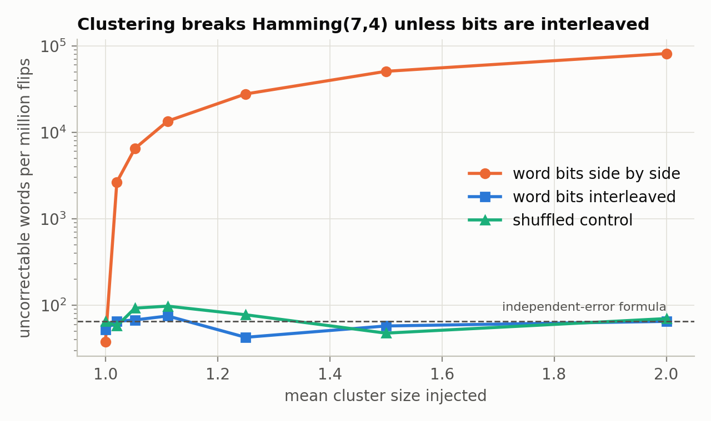
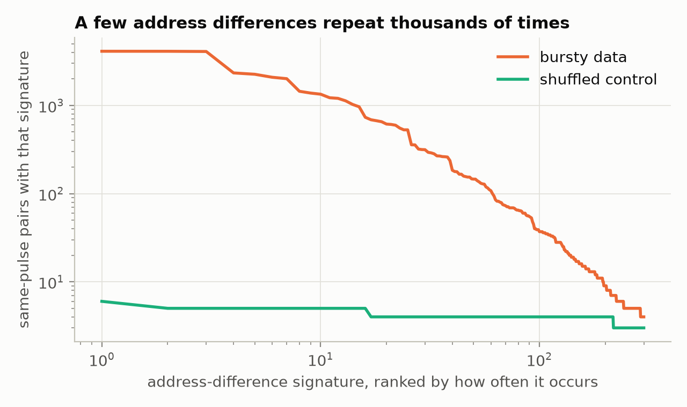
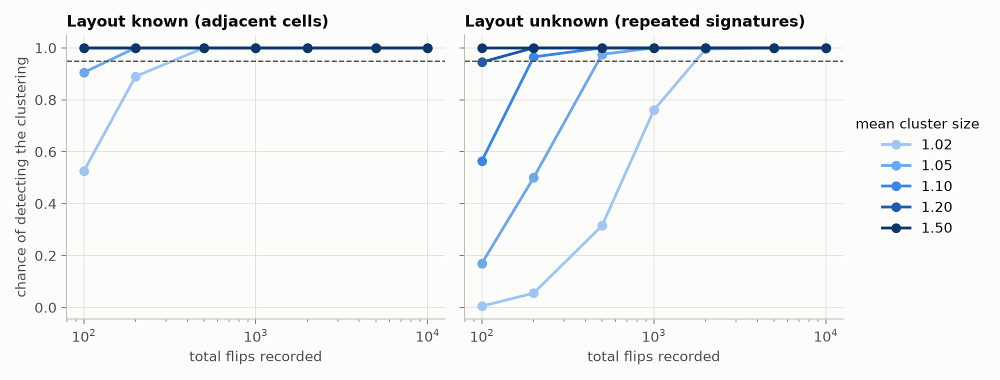

# BURST: preliminary results and what they change

**Status: simulation only.** Nothing here is beam data. We injected bit flips with a known amount of clustering into a virtual 917,504-bit memory, ran the analysis we plan to run on CLEAR data, and checked that it recovers what we put in. Code: `burst_sim/burst_sim.py`. Numbers: `burst_sim/results.json`. Figures: `burst_sim/figures/`.

Re-run with `burst_sim/.venv/bin/python burst_sim/burst_sim.py` (about 20 seconds, fixed random seed).

## What the fault-injection study shows

### 1. The time test works, and beam charge jitter fakes a positive

| Injected data (5,000 pulses, 20 flips each) | Fano factor measured | Expected from injection | Verdict |
|---|---|---|---|
| Independent flips | 1.00 | 1.00 | consistent with Poisson (p = 0.40) |
| Bursty, mean cluster 1.5 | 2.03 | 2.00 | Poisson rejected |
| Independent, 10% charge jitter | 1.20 | 1.20 | Poisson rejected (p = 4e-22), **wrongly** |
| Same, after dividing by measured charge | 1.00 | 1.00 | consistent with Poisson (p = 0.44) |

The Fano factor is variance divided by mean of the flips per pulse; independent flips give 1. A 10% pulse-to-pulse variation in bunch charge produces a false clustering signal unless every pulse is normalised to its measured charge. **The proposal must request the per-pulse charge reading from CLEAR.**

### 2. The spatial test recovers the injected clusters

- Injected mean cluster size 1.497; recovered 1.496. Injected multi-cell fraction 33.3%; recovered 33.2%.
- Adjacent flipped pairs: 33,287 observed against 2.6 expected for independent flips.
- Shuffled control (same flips per pulse, random addresses): 4 pairs against 2.6 expected, p = 0.27. No false signal.

### 3. Clustering breaks a Hamming code unless the bits are interleaved

Uncorrectable Hamming(7,4) words in 20,000 pulses (about 400,000 flips), scrubbing after every pulse:

| Mean cluster size | Word bits side by side | Word bits interleaved | Shuffled control |
|---|---|---|---|
| 1.00 | 27 | 27 | 21 |
| 1.02 | 1,724 | 41 | 31 |
| 1.11 | 7,965 | 36 | 20 |
| 1.50 | 20,371 | 31 | 37 |
| 2.00 | 24,995 | 22 | 32 |

The independent-error formula predicts 26. Even 2% of flips arriving as pairs raises failures about 65-fold when a word's bits are physical neighbours. Interleaving returns the rate to the independent level. Brute-force check included: Hamming(7,4) fails for exactly the error patterns with two or more flipped bits.

### 4. How many flips we need (this sets the beam-time request)

Flips needed for a 95% chance of detecting clustering at a 0.1% false-alarm threshold:

| Mean cluster size | Spatial test | Time test |
|---|---|---|
| 1.02 | 500 | more than 50,000 |
| 1.05 | 200 | 50,000 |
| 1.10 | 100 | 10,000 |
| 1.20 | 100 | 5,000 |
| 1.50 | 100 | 500 |

The spatial test is 5 to over 100 times more sensitive. False-alarm rates on independent data at a 5% threshold were 4.2% (spatial) and 5.9% (time), as they should be.

### 5. Adaptive scrubbing helps one failure type and not the other

Beam alternating between 30 and 300 flips per pulse; a controller scrubs faster when its running estimate of the flip rate is higher, using the same number of scrubs as a fixed schedule.

- Interleaved layout: 38 to 40% fewer uncorrectable words at every scrub budget, for independent and bursty flips alike.
- Side-by-side layout with bursty flips, 1,200 scrubs: 54,849 fixed against 53,614 adaptive, a 2% gain. Those failures happen inside a single pulse, so no scrub schedule can prevent them.

### 6. Clusters can be found without knowing the chip's layout
Code: `burst_sim/blind_bitmap.py`. Numbers: `burst_sim/results_blind.json`.

A real memory scrambles logical addresses before they reach a physical row and column, and manufacturers rarely publish the map. We hid the injected clusters behind an unknown scramble and gave the analysis only what the microcontroller would log: pulse number, word address, bit number.

**Method.** For every pair of flips in the same pulse, take the XOR of the two logical addresses. Unrelated pairs spread over about a million possible values. Physical neighbours give the same few values again and again.

| Flips recorded | Injected mean cluster | Recovered, layout known | Recovered, layout unknown | Shuffled control |
|---|---|---|---|---|
| 2,070 | 1.491 | 1.490 | 1.465 | 1.000 |
| 10,067 | 1.497 | 1.497 | 1.488 | 1.000 |
| 99,040 | 1.499 | 1.498 | 1.499 | 1.000 |

The shuffled control never learned a single false signature.

Flips needed for a 95% chance of detection at a 0.1% false-alarm threshold:

| Mean cluster size | Layout known | Layout unknown |
|---|---|---|
| 1.02 | 500 | 2,000 |
| 1.05 | 200 | 500 |
| 1.10 | 100 | 200 |
| 1.20 | 100 | 200 |
| 1.50 | 100 | 100 |

Not knowing the layout costs a factor of 2 to 4 in data, not a factor of 100. False-alarm rate on independent data at a 5% threshold: 3.2%.

**The decoder question needs no layout at all.** Counting words that hold two or more flips after one pulse uses only logical addresses. In 100,000 bursty flips: 5 such words on an interleaved chip (shuffled control 2), 5,157 on a side-by-side chip (shuffled control 3). So the experiment tells us directly whether a given chip's own layout protects a code against bursts.

**Limits.** The scramble modelled is a permutation and inversion of address bits, which is common but not universal. A chip with an arbitrary lookup-table scramble or spare-row remapping would weaken the method. It also relies on few flips per pulse; at hundreds per pulse the chance pairs swamp the signal.

## What this changes in the proposal

1. **Sharper hypothesis.** "Failures from accumulation are fixed by adaptive scrubbing; failures from bursts are fixed only by interleaving. We measure which kind CLEAR produces." This is testable and has a prediction for each outcome.
2. **The spatial test carries the experiment, and it no longer depends on a published bitmap.** Section 6 shows clusters can be detected and sized from logical addresses alone. A known bitmap is still better and remains a plus when choosing a device, but it is not a kill criterion.
3. **Flip target: about 2,000 per configuration** covers clusters down to 2% even with the layout unknown. Convert to beam time once the upset cross-section is estimated. Keep the rate to a few flips per pulse.
4. **Controls to name explicitly:** per-pulse charge normalisation, shuffled-address control, beam-off run.
5. **If no upsets are seen:** the 95% upper limit on cross-section per bit is 3.0 / (fluence × number of bits).

## What is still not done

- **Flip rate at CLEAR is unknown.** The rates used here (5 to 300 flips per pulse) are placeholders. Needs the Geant4 or FLUKA estimate and a literature cross-section.
- **CLEAR beam parameters not read.** The 2027 Beams & Detectors document is over 10 MB and did not download in this session. Read it for energy, charge per pulse, repetition rate, and whether own electronics are allowed.
- **Line-shaped clusters and a geometric size distribution are assumptions.** Real multi-cell upsets depend on the cell layout.
- **Within-pulse timing is not modelled**, because a CLEAR bunch is far shorter than any readout. "Time clustering" here means pulse-to-pulse.

## Team

Rules from the 2027 invitation: at least five members, every member enrolled in secondary or high school in 2026/27, students write the proposal, coach advises.

| Person | Role | First task |
|---|---|---|
| Sashreek | Lead; decoder and adaptive controller; readout firmware logic | Choose candidate memory devices and settle the bitmap question (item 2) |
| Prithwijit | Simulation and analysis owner | Take over `burst_sim.py`; add a realistic multi-cell-upset shape model; start the neutron and electron yield estimate |
| Logan | Radiation physics: secondaries, cross-sections, literature | Produce a flips-per-pulse estimate from published electron and neutron upset cross-sections (confirmed enrolled in high school 2026/27) |
| Open seat 4 | Hardware build: microcontroller, memory boards, remote logging | Bench prototype that writes a pattern, reads back, logs flips |
| Open seat 5 | Dosimetry, shielding plan, outreach section | Draft the 200-word outreach activity and run it before March |
| Coach (needed) | Adult contact for submission; ideally a teacher | Register as contact person |

Deadline: 12 March 2027, 23:59 CET.
