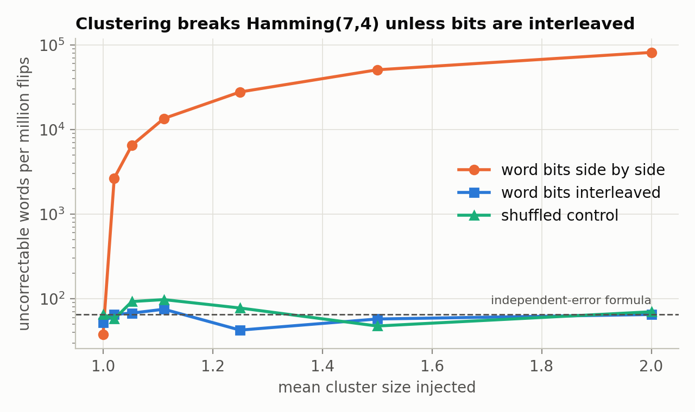

# BURST: do beam-induced memory errors come in bursts?

Working repo for our entry to CERN's [Beamline for Schools 2027](https://beamlineforschools.cern/) competition.

**The question.** When memory chips are irradiated at CERN's CLEAR electron accelerator, are the bit flips independent, or do they cluster in space and time? How much does clustering hurt a standard error-correcting code, and what fixes it?

**Status.** Proposal in preparation. Deadline: 12 March 2027, 23:59 CET. No beam data exists yet; everything numerical here is simulation.

## Start here

| File | What it is |
|---|---|
| [BURST_preliminary_results.md](BURST_preliminary_results.md) | Results of the fault-injection simulation, what they change in the proposal, open problems, team roles |
| [Idea.docx](Idea.docx) | The proposal plan and outline |
| [Reading and Learning.docx](Reading%20and%20Learning.docx) | Reading list, in suggested order |
| [SUGGESTED UPGRADES.docx](SUGGESTED%20UPGRADES.docx) | Proposed upgrades to the base idea |
| [burst_sim/](burst_sim/) | Simulation code, figures and raw numbers |
| [Light_guided_lattice.pdf](Light_guided_lattice.pdf) | LUMEN, an earlier idea for the T9 beamline. Shelved: T9 is not available in 2027 |

## Main findings so far (simulated)

- The planned analysis recovers injected clusters, and a shuffled control shows no false signal.
- Pulse-to-pulse charge jitter fakes a clustering signal unless each pulse is normalised to its measured charge.
- Even 2% of flips arriving as adjacent pairs raises Hamming(7,4) failures about 65-fold when a word's bits are physical neighbours. Interleaving the bits removes the effect.
- A spatial test needs a few hundred flips to detect clustering; a time-only test needs thousands to tens of thousands.
- Clusters can be detected and sized from logical addresses alone, without the chip's physical layout, at a cost of 2 to 4 times more data.
- Adaptive scrubbing cuts failures from accumulated flips by about 40% but does almost nothing against bursts.



## Run the simulation

```bash
cd burst_sim
python3 -m venv .venv
.venv/bin/pip install -r requirements.txt
.venv/bin/python burst_sim.py
```

Takes about 20 seconds. Rewrites `figures/` and `results.json`. The random seed is fixed, so results reproduce exactly.

## Biggest open questions

1. Expected flips per pulse at CLEAR (needs a yield and cross-section estimate).
2. Which memory devices to use, and whether their address scrambling is the simple kind our layout-blind method assumes.
3. CLEAR beam parameters and whether teams may bring their own electronics.

## Competition rules that matter

At least five team members, all enrolled in secondary or high school in 2026/27. Up to 1000 words, plus an optional 200-word outreach section. The students write the proposal; the coach advises.
